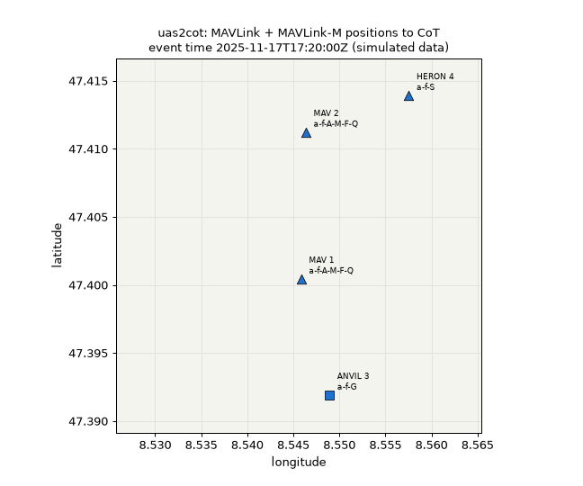

# uas-cot: drones belong on the TAK map, weapons messages do not belong on the wire

[](https://crates.io/crates/uas-cot)
[](https://docs.rs/uas-cot)
[](https://github.com/Mattbusel/uas-cot/actions/workflows/ci.yml)

**Your TAK map shows fake drones as real ones, and nothing on the marker
tells the operator.** Remote ID bridges decode a broadcast and paint it. The
broadcast is not a proof. We threw 10 fake drones at eight open-source
Remote ID receivers: **0 of 10 flagged, 62 of 80 receiver and transmitter
pairs shown as real drones**
([receipts](https://github.com/Mattbusel/remoteid/blob/main/docs/receivers.md)).
Feed that to TAK and a five dollar ESP8266 puts an aircraft and a pilot
location in front of a security team, with the same marker as a real one.
A bridge that can't say SPOOFED is passing the attacker's message along.

uas-cot does not send an unjudged Remote ID marker from `uas2cot pcap`:
every aircraft carries the [`remoteid`](https://crates.io/crates/remoteid)
trust verdict in its remarks, `Trust: spoofed (teleport, known_spoofer; ...)`
or `Trust: plausible.`, and remoteid flags all 10 corpus spoofers. MAVLink-M
support is telemetry and position only: every targeting, fires and
engagement message is refused at compile time and at run time, not by a
config flag.

| What reaches the TAK map | A decode-only Remote ID bridge | uas-cot |
|---|---|---|
| Spoofed Remote ID transmitter | an ordinary aircraft marker | a marker whose remarks say `Trust: spoofed (...)` |
| Why to believe it | nothing | teleport, frozen timestamp, spoofer fingerprint, DRIP signature result |
| MAVLink-M targeting and engagement messages | | refused at compile time and at run time |
| CoT output | | checked against the MITRE CoT schemas in CI |

Drone data arrives in four standards that do not talk to each other: Remote ID in the air, MISB KLV in the video, MAVLink on the control link, Cursor on Target on the TAK map. uas-cot puts all of them on the map, and draws a hard line: every MAVLink-M target, track, handover, fires, munition and engagement message is refused at compile time and at run time. In drone code a default is a claim about a real aircraft (a fix we upstreamed stopped a default MAVLink HEARTBEAT from serializing as SAFETY_ARMED: [rust-mavlink #576](https://github.com/mavlink/rust-mavlink/pull/576)), so interoperability code should make the dangerous message impossible to send by accident, not just undocumented.

- Remote ID (Wi-Fi Beacon, NAN, Bluetooth via [`remoteid`](https://crates.io/crates/remoteid)): aircraft and operator markers
- MISB ST 0601 KLV from STANAG 4609 video (via [`misb`](https://crates.io/crates/misb)): platform, camera field of view, sensor point of interest
- MAVLink `GLOBAL_POSITION_INT`: vehicle markers, from a `.tlog` or live UDP
- MAVLink-M (Dronecode `military.xml`, feature `mavlink-m`): friendly position reports (`PARTICIPANT_POSITION`) as CoT markers, plus `mavlinkm-check`, a framing and checksum checker for MAVLink-M traffic. Telemetry and position interoperability only: every target, track, handover, fires, munition and engagement message, and every generic payload (`PAYLOAD_*`) message, is refused at compile time and at run time. See [docs/mavlink-m.md](docs/mavlink-m.md)
- Remote ID affiliation rules: mark your own fleet friendly by serial or Operator ID (`--friendly`), and a spoofed or suspicious transmitter is never drawn friendly, even when it copies one of your serials
- The Remote ID ground position labelled for what it is: a takeoff point gets its own `rid-takeoff-<id>` marker instead of a marker that says "operator"
- Sends to the SA multicast group (239.2.3.1:6969), a TAK Server TCP input, a TAK Server TLS input with a client certificate (feature `tls`, rustls, no OpenSSL), or stdout
- Output passes the MITRE CoT schemas and converts cleanly to TAK Protocol v1

## Install

```
cargo install uas-cot                       # Remote ID, KLV, MAVLink
cargo install uas-cot --features mavlink-m  # plus MAVLink-M and mavlinkm-check
cargo install uas-cot --features tls        # plus TAK Server TLS (8089) streaming
```

## Use

```
uas2cot pcap capture.pcap --udp 239.2.3.1:6969        # Remote ID from a Wi-Fi capture
uas2cot pcap capture.pcap --friendly MFG1A0123456789 --suspicious-as s     --tls takserver:8089 --ca ca.pem --cert user.pem --key user.key   # your fleet friendly, over TLS
uas2cot klv flight.klv --video rtsp://cam/1 --realtime   # ffmpeg -i in.ts -map 0:d -c copy -f data flight.klv
uas2cot tlog flight.tlog --tcp takserver:8087
uas2cot mavlink-udp 0.0.0.0:14550 --udp 239.2.3.1:6969   # with mavlink-m: MAVLink-M friendly positions too
mavlinkm-check tlog flight.tlog                           # MAVLink-M traffic against military.xml
```



*uas2cot output for the simulated scenario in `examples/mavlink_m_sim.rs`
(synthetic data): two drones, plus a friendly ground team and a friendly
survey boat relayed as MAVLink-M PPLI reports.*

As a library:

```rust
use uas_cot::{mavlink, net::UdpSender};

let pos = mavlink::GlobalPositionInt { lat: 473_977_418, lon: 85_455_939, alt: 488_000, ..Default::default() };
if let Some(event) = mavlink::vehicle(1, &pos, Some(2), uas_cot::now_us(), &Default::default()) {
    UdpSender::sa_multicast()?.send(&event)?;
}
# Ok::<(), std::io::Error>(())
```

### Who is friendly, and where the pilot is not

```rust
use uas_cot::rid::{self, AffiliationRules, Options};

let rules = AffiliationRules::default()   // spoofed verdict: suspect (s)
    .friendly_id("MFG1A0123456789")       // our drone: friendly (f) ...
    .suspicious_as('s');                  // ... unless its broadcast looks fake
// uas: the &TrackedUas that remoteid's Tracker::ingest returns
let events = rid::tracked_with(uas, None, uas_cot::now_us(), &Options::default(), &rules);
```

A friendly list matched on serial numbers alone is what a spoofer exploits:
the serial is in the broadcast, so anyone can copy it. `AffiliationRules`
checks the remoteid verdict first, and only a transmitter that is not
spoofed or suspicious can match the list (`require_authenticated_friendly`
makes it DRIP signed only).

Remote ID sends one ground position with a type: live operator GNSS, a
fixed operator location, or the takeoff point. A marker that calls all
three "operator" (as uas-cot 0.5 did) sends a security team to where the
drone left from, not to where the pilot stands. In both Open Drone ID sample captures in `tests/data`
the position is the takeoff point; `tracked_with` and `uas2cot` put it on
the map as `Takeoff point of MFG1A0123456789`, a separate entity from any
live operator marker.

## Docs

- [docs/integration.md](docs/integration.md): using it as a library (features, the API to depend on, MSRV, versioning)
- [docs/mapping.md](docs/mapping.md): which field goes where
- [docs/mavlink-m.md](docs/mavlink-m.md): MAVLink-M scope (what is blocked and how), mapping, the conformance checks, the demo
- [docs/tak.md](docs/tak.md): seeing it in ATAK, WinTAK and TAK Server
- [docs/testing.md](docs/testing.md): how it is checked
- API: [docs.rs/uas-cot](https://docs.rs/uas-cot)

## License

MIT OR Apache-2.0. `dialects/military.xml` is from
[Dronecode/mavlink-military](https://github.com/Dronecode/mavlink-military),
MIT, Copyright (c) 2026 Dronecode Project, Inc (`dialects/LICENSE-MIT-dronecode`).
