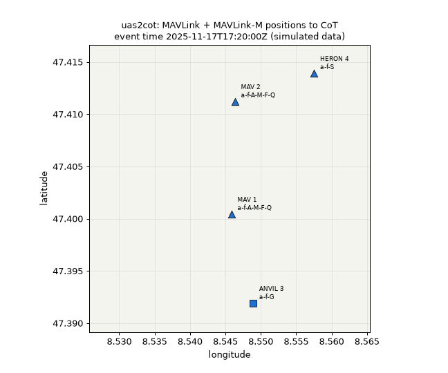

# MAVLink-M to CoT, and conformance checks

[MAVLink-M](https://mavlink-m.dronecode.org/) is the military dialect of
MAVLink 2 that Dronecode publishes as `military.xml` in
[Dronecode/mavlink-military](https://github.com/Dronecode/mavlink-military)
(MIT). Its own header says it is shaped to translate "through a gateway"
into the C2 formats forces already run. uas-cot's `mavlink-m` feature is
that gateway for TAK: MAVLink-M track messages in, Cursor on Target out,
next to the vehicle markers uas-cot already makes from `GLOBAL_POSITION_INT`.
It also ships a checker that tests MAVLink-M traffic against the definition.

Scope: interoperability and telemetry. The gateway translates the public
dialect's descriptive fields onto a map picture. It never reads engagement
fields into an event (see "Not translated" below).



*The GIF is drawn from `uas2cot` output (every frame is a CoT event the
gateway produced) for the scripted, simulated scenario in
`examples/mavlink_m_sim.rs`. It is not a recording of real aircraft or of a
TAK client.*

## Try it

```
cargo install uas-cot --features mavlink-m

# translate live MAVLink + MAVLink-M from UDP to the TAK SA multicast group
uas2cot mavlink-udp 0.0.0.0:14550 --udp 239.2.3.1:6969

# check MAVLink-M traffic against military.xml (exit code 1 on any error)
mavlinkm-check udp 0.0.0.0:14550 --count 500
mavlinkm-check tlog flight.tlog
mavlinkm-check raw capture.bin          # back-to-back frames, for example a serial capture
mavlinkm-check tlog flight.tlog --dialect path/to/mavlink-military/military.xml
```

Without hardware, from a clone of this repository:

```
cargo run --features mavlink-m --example mavlink_m_sim -- --tlog demo.tlog --secs 90 --fault
cargo run --features mavlink-m --bin uas2cot -- tlog demo.tlog > demo.cot
cargo run --features mavlink-m --bin mavlinkm-check -- tlog demo.tlog
python tools/validate_cot.py tests/schema/cot-all.xsd demo.cot
python tools/cot_gif.py demo.cot demo.gif
```

Live, in two terminals:

```
cargo run --features mavlink-m --bin uas2cot -- mavlink-udp 127.0.0.1:14560
cargo run --features mavlink-m --example mavlink_m_sim -- --udp 127.0.0.1:14560 --secs 60
```

To use a PX4 or ArduPilot SITL as the vehicle side, point the gateway at
the SITL's MAVLink UDP output (PX4 SITL sends to port 14550 by default).
The SITL supplies `HEARTBEAT` and `GLOBAL_POSITION_INT`; MAVLink-M
messages come from whatever payload or mission computer on the network
speaks the dialect (or from the simulator above on the same port).

What the scenario contains, all synthetic and sent with
`sidc_context = SIMULATION`, around the PX4 SITL default home
(47.397742, 8.545594):

| Source | Messages | CoT |
|---|---|---|
| System 1, quadrotor | `HEARTBEAT`, `GLOBAL_POSITION_INT` 10 Hz | `mav-1`, `a-f-A-M-F-Q` |
| System 2, fixed wing | `HEARTBEAT`, `GLOBAL_POSITION_INT` 10 Hz | `mav-2`, `a-f-A-M-F-Q` |
| Ground team "ANVIL 3", relayed by system 1 | `PARTICIPANT_POSITION` 1 Hz | `mavlink-m-ppli-3`, `a-f-G` |
| A vehicle tracked by system 1, handed to system 2 | `TRACK_IDENTITY` every 5 s (suspect, light tactical vehicle), `TARGET_HANDOVER` 1 Hz | `mavlink-m-track-<uuid>`, `a-s-G-E-V-U`, callsign `SIM TRUCK` |
| `--fault` | one `TRACK_IDENTITY` with `pid_status = 9` (undefined) | dropped by the gateway, reported by the checker |

Output of the steps above on this machine (Windows 11, Rust 1.100):

```
mavlink_m_sim: wrote 2179 records to demo.tlog
uas2cot: 1997 events
TRACK_IDENTITY (53000) from 1/1
  error [pid_status]: 9 is not a defined MAVLINK_M_PID_STATUS value
mavlinkm-check: 199 MAVLink-M messages checked against military (embedded, commit 6375c3447c08), 1 with errors
  PARTICIPANT_POSITION: 90 checked, 0 with errors
  TARGET_HANDOVER: 90 checked, 0 with errors
  TRACK_IDENTITY: 19 checked, 1 with errors
1997 events, 0 invalid                     (MITRE CoT schemas)
1997 events converted to TAK Protocol v1 (mesh and stream) and checked
```

## Mapping

| MAVLink-M | CoT |
|---|---|
| `TRACK_IDENTITY` (53000) | no event of its own; it sets the identity of the track with the same `track_uid` and re-issues that track's marker if it has a position |
| `TARGET_HANDOVER` (53002) | `uid` `mavlink-m-track-<track_uid as UUID>`; `point` from `lat`, `lon` (degE7), `alt` (MSL, `altsrc="MSL"`); `ce` = sqrt(max(`cov_pos_x`, `cov_pos_y`)), `le` = sqrt(`cov_pos_z`); `track` from `vx`, `vy`; `stale` = `valid_until_usec`; `callsign` = `target_name`; `<link relation="p-p">` to `mav-<sender>`; remarks: sender and receiving system, class, force, confidence, media URL, track UID |
| `PARTICIPANT_POSITION` (53003) | `uid` `mavlink-m-ppli-<origin_sysid>`; type `a-<identity>-<ppli_type dimension>`; `callsign`; remarks: type, identity, external track number |
| `TARGET` (53010) | `uid` `mavlink-m-target-<sender>-<target_id>`; type from class, else domain; remarks: class, domain, force, confidence (`confidence` / 10000), sensor, data-quality flags |

Affiliation: `stanag_identity` (from `TRACK_IDENTITY` when the track has
one) maps pending, unknown, assumed friend, friend, neutral, suspect,
hostile to CoT `p u a f n s h`; without it, `target_force` maps unknown,
neutral, friendly, foe to `u n f h`.

Dimension and function: `target_class` to a MIL-STD-2525B function, for
example main battle tank `G-E-V-A-T`, infantry fighting vehicle
`G-E-V-A-I`, multirotor UAS `A-M-H-Q`, patrol boat `S-C-P`, submarine
`U-S`, satellite `P-S`. Classes with no fixed dimension (unknown, emitters,
network nodes, other) use the `environment` or `target_domain`, then `X`.
Every code the gateway can emit is checked against the 2525B change 2
function tables in `tests/mavlink_m.rs`.

Exercise and simulation tracks (`sidc_context` 1 or 2) get `EX ` or `SIM `
in front of the callsign and say so first in the remarks, because CoT has
no field for the reality context and a simulated track must not look real
on a shared map.

Covariances of zero, negative or NaN mean unknown (`9999999`), so a
zero-filled field never claims a perfect fix.

## Not translated

These fields are never read into an event: `authorization` (handover
token), `prf_code` (laser code), target package endpoints, port and path,
`cep_desired`, `cep_max`, `tle_category`, `dmpi_reference_kind`,
`restricted_target_flags`, and the `AUTHORIZATION_REQUIRED` and
`INTEGRITY_PRESENT` target flags. The fires, ESAD, stores, remote weapon
station, CAS and terminal control messages are not translated at all. The
test `target_excludes_engagement_fields` fails if any of those values
appears in the XML.

## Conformance checks

`mavlinkm-check` and `uas_cot::mavlink_m::validate` read every rule from
the definition, so a newer `military.xml` passed with `--dialect` is
checked by its own rules.

| Check | From the XML |
|---|---|
| message id is defined | `<message id>` |
| length: MAVLink 1 exact; MAVLink 2 not longer than the message, trailing zero bytes trimmed (warning if not) | field types, `<extensions/>` |
| checksum with the message's `CRC_EXTRA` (a mismatch means the sender built from a different definition, or corruption) | field names, types, order |
| enum fields hold a defined value | `enum=`, `<entry>` |
| protected enums (values pairwise 4 or more bits apart): an undefined value is reported as corruption, with the nearest codeword and its distance; the dialect says receivers reject it rather than correct it | entry values |
| bitmask fields set no undefined bits | `bitmask="true"` |
| `degE7` latitude and longitude in range | `units="degE7"` |
| ranges stated in descriptions: `[0.0-1.0]`, `[0-100]` with `255 = N/A`, `0 to 10000` | `<description>` |
| fields described "Never 0" are not 0 (for example `TARGET_HANDOVER.target_system`) | `<description>` |
| `char[N]` is valid UTF-8; a track UID is not all zero unless the description allows it | types, `<description>` |

The gateway runs the same checks and drops a message that fails
(`Options::reject_invalid`, on by default).

How the layout is verified: `tests/data/mavlink_m_reference.txt` holds
`CRC_EXTRA`, base length and full length of all 35 MAVLink-M messages as
pymavlink 2.4.50 computes them; `layout_matches_pymavlink` compares the
crate's own computation with every one.

## Version

The embedded `military.xml` is Dronecode/mavlink-military commit
`6375c3447c08` (2026-10-28), unchanged, in `dialects/`. MAVLink-M is still
moving; pass `--dialect` (or `Dialect::from_file`) to use a newer copy.
